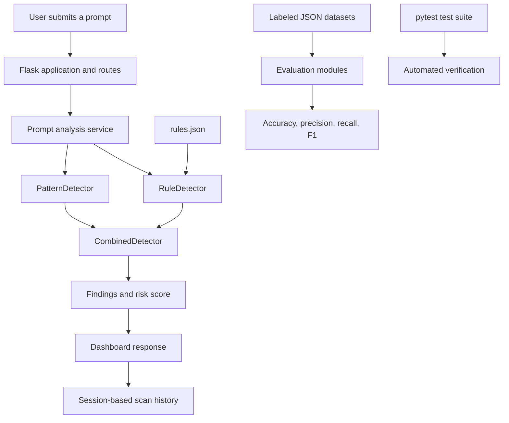

# PromptGuard — Prompt Injection Detection and Defense Evaluation

PromptGuard is a local Flask web application for detecting suspicious prompt-injection attempts using a configurable, rule-based heuristic detection engine. It combines regular-expression patterns, structured detection rules, risk scoring, and a web dashboard to analyze prompts and evaluate detection performance.

The project is designed for experimentation and evaluation. The current detection engine does not require a large language model, model downloads, or external AI API calls.

## Table of Contents

- [Project Overview](#project-overview)
- [Technology Stack](#technology-stack)
- [Architecture](#architecture)
- [Detection Workflow](#detection-workflow)
- [Dataset and Class Ratio](#dataset-and-class-ratio)
- [Evaluation Results](#evaluation-results)
- [Installation and Setup](#installation-and-setup)
- [Running the Application](#running-the-application)
- [Running Evaluations and Tests](#running-evaluations-and-tests)
- [Project Structure](#project-structure)
- [Limitations and Future Improvements](#limitations-and-future-improvements)

## Project Overview

PromptGuard aims to identify prompt content that attempts to override instructions, extract hidden information, bypass safety restrictions, or perform other suspicious actions.

### Main features

- Regular-expression detection of common prompt-injection patterns.
- Configurable structured rules for combining multiple signals.
- Combined detector that consolidates findings and calculates a risk score.
- Flask-based web interface for submitting and analyzing prompts.
- Scan results, risk metadata, and session-based scan history.
- Labeled datasets containing attack and safe prompts.
- Evaluation metrics including accuracy, precision, recall, and F1-score.
- Automated tests and a GitHub Actions continuous integration workflow.

## Technology Stack

| Technology | Purpose |
|---|---|
| Python | Core application and detection logic |
| Flask | Web application and HTTP routes |
| Regular expressions (`re`) | Pattern-based prompt detection |
| JSON | Detection rules and labeled evaluation datasets |
| HTML, CSS, JavaScript | Web interface and dashboard |
| pytest | Automated testing |
| Git and GitHub | Version control and collaboration |
| GitHub Actions | Automated CI workflow |

The current implementation uses heuristic detection rather than model-based classification. This makes the detection process lightweight and locally executable, but its performance depends on the patterns, rules, and scoring logic that have been implemented.

## Architecture

PromptGuard uses a modular architecture that separates the web interface, detection logic, configurable data, and evaluation components.



### Core components

**1. Flask application and routes**

The application accepts prompt submissions, invokes the detection functionality, and returns analysis results to the web interface.

**2. PatternDetector**

Uses regular expressions and predefined patterns to identify suspicious content, including:

- Instruction overrides and hierarchy manipulation.
- Attempts to reveal system prompts or confidential context.
- Jailbreak language and safety-restriction bypasses.
- Credential theft and sensitive-information requests.
- Data exfiltration and unauthorized disclosure.
- Role or authority impersonation.
- Other suspicious or potentially harmful instructions represented by the implemented patterns.

**3. RuleDetector**

Loads configurable multi-signal rules from `promptguard/data/rules.json`. It can combine related signals to identify suspicious prompt behavior.

**4. CombinedDetector**

Combines findings from the detection components, avoids duplicate finding names, calculates a bounded weighted score, and produces risk metadata for the application.

**5. Evaluation modules**

The evaluation scripts load labeled prompts, compare predicted labels against expected labels, and calculate classification metrics. Separate development, holdout, and robustness datasets support different evaluation purposes.

**6. Automated tests and CI**

The pytest suite checks detector behavior, scoring, metrics, evaluation logic, and application routes. GitHub Actions provides automated test execution through the repository's CI workflow.

## Detection Workflow

The high-level detection process is:

1. A user submits a prompt through the Flask interface.
2. The application passes the prompt to the analysis logic.
3. Pattern-based detection checks for known suspicious text patterns.
4. Rule-based detection evaluates configured signals.
5. The combined detector consolidates findings and computes the risk score.
6. The application returns the findings and risk metadata to the user.
7. Evaluation scripts independently compare detector predictions with labeled examples.

The risk score is a heuristic indicator based on implemented signals. **It is not a calibrated probability that a prompt is malicious.**

## Dataset and Class Ratio

The combined dataset is stored at:

`promptguard/data/combined_cases.json`

The main test dataset is stored at:

`promptguard/data/test_cases.json`

The combined dataset has been validated to contain 148 records, with unique IDs and valid JSON structure.

### Dataset distribution

| Label | Records | Percentage |
|---|---:|---:|
| Attack | 124 | 83.78% |
| Safe | 24 | 16.22% |
| **Total** | **148** | **100%** |

The attack-to-safe ratio is **124:24**, which simplifies to **31:6**. The dataset is therefore attack-heavy rather than balanced.

### Dataset record format

Each record includes:

| Field | Description |
|---|---|
| `id` | Unique record identifier |
| `prompt` | Text submitted to the detector |
| `expected_label` | Expected classification: `attack` or `safe` |
| `category` | Attack or prompt category |
| `reason` | Explanation for the assigned label |

Some attack records may include additional metadata, such as severity.

### Dataset files

| File | Purpose |
|---|---|
| `test_cases.json` | Main labeled prompt dataset |
| `combined_cases.json` | Combined 148-record dataset |
| `development_cases.json` | Development dataset for examining and improving detection behavior |
| `holdout_cases.json` | Separate holdout dataset for evaluation |
| `robustness_cases.json` | Dataset for robustness checks |
| `rules.json` | Configurable detection rules |

`combined_cases.json` was created as a copy of `test_cases.json` at the time of dataset creation. They should be kept synchronized or assigned clearly different purposes if they evolve separately.

The dataset is useful for repeatable experiments, but its attack-heavy distribution should be considered when interpreting metrics. Accuracy alone may not adequately describe performance across both classes.

## Evaluation Results

PromptGuard reports the following metrics:

- **Accuracy:** Fraction of all examples classified correctly.
- **Precision:** Fraction of predicted attacks that are actual labeled attacks.
- **Recall:** Fraction of labeled attacks correctly detected.
- **F1-score:** Harmonic mean of precision and recall.

### Previously recorded evaluation results

These are results from earlier evaluation runs; they are not a claim that every dataset currently achieves the same performance.

| Evaluation | Dataset size | Accuracy | Precision | Recall | F1-score |
|---|---:|---:|---:|---:|---:|
| Original main evaluation | 48 | 100.0% | 100.0% | 100.0% | 100.0% |
| Development evaluation | 20 | 85.0% | 100.0% | 70.0% | 82.3% |
| Holdout evaluation | 24 | 83.3% | 90.0% | 75.0% | 81.8% |
| Robustness evaluation | 12 | 100.0% | 100.0% | 100.0% | 100.0% |

The original 48-prompt evaluation and the 12-prompt robustness evaluation achieved perfect scores on their respective datasets. The larger combined dataset contains 148 records, so its performance must be measured by running the evaluator against that dataset.

The development run missed three attack examples involving unauthorized tool use, instruction override, and prompt extraction. The holdout run recorded three false negatives and one false positive. These results illustrate why performance on a small dataset should not be treated as proof of generalization.

**Evaluation integrity:** Keep the holdout set separate from rule tuning and threshold selection. Use the development dataset to guide changes, then evaluate the final configuration on the holdout dataset without tuning against its results.

### Run the existing evaluation scripts

From the project root, with the virtual environment activated:

```powershell
python -m promptguard.evaluation.evaluate
python -m promptguard.evaluation.evaluate_development
python -m promptguard.evaluation.evaluate_holdout
python -m promptguard.evaluation.evaluate_robustness
```

These commands run the corresponding existing evaluation modules. Confirm each module's configured input path before interpreting its output as a result for a particular dataset.

### Validate the combined dataset

```powershell
python -m json.tool promptguard/data/combined_cases.json > $null
```

Check the record counts and labels:

```powershell
python -c "import json,collections; d=json.load(open('promptguard/data/combined_cases.json',encoding='utf-8')); print('Total:',len(d)); print('Labels:',dict(collections.Counter(x['expected_label'] for x in d))); print('Unique IDs:',len({x['id'] for x in d}))"
```

Expected counts are 148 total records, 124 attacks, 24 safe prompts, and 148 unique IDs.

## Installation and Setup

### Prerequisites

- Python installed on Windows.
- Git for cloning the repository.
- PowerShell or a compatible terminal.

### 1. Clone the repository

```powershell
git clone https://github.com/MeazbahMehedi/promptguard.git
cd promptguard
```

### 2. Create and activate a virtual environment

```powershell
python -m venv .venv
.\.venv\Scripts\Activate.ps1
```

If PowerShell blocks activation, run:

```powershell
Set-ExecutionPolicy -Scope Process -ExecutionPolicy Bypass
.\.venv\Scripts\Activate.ps1
```

### 3. Install dependencies

```powershell
python -m pip install --upgrade pip
pip install -r requirements.txt
```

## Running the Application

Start the Flask application from the project root:

```powershell
python app.py
```

Open the following address in your browser:

`http://127.0.0.1:5000/`

Stop the development server with `Ctrl+C`.

## Running Evaluations and Tests

Run the automated test suite:

```powershell
python -m pytest -q
```

For detailed test output:

```powershell
python -m pytest -v
```

A previously recorded test run completed with **37 passing tests**. Run the commands above to verify the current checkout, as the count may change when tests are added or modified.

The repository also includes a GitHub Actions workflow for automated testing. Its status should be checked on GitHub to confirm the result for the latest commit.

## Project Structure

```text
promptguard/
├── .github/
│   └── workflows/
│       └── tests.yml
├── app.py
├── requirements.txt
├── README.md
├── docs/
│   └── dataset_schema.md
├── promptguard/
│   ├── data/
│   │   ├── combined_cases.json
│   │   ├── development_cases.json
│   │   ├── holdout_cases.json
│   │   ├── robustness_cases.json
│   │   ├── rules.json
│   │   └── test_cases.json
│   ├── detectors/
│   │   ├── base.py
│   │   ├── pattern_detector.py
│   │   ├── rule_detector.py
│   │   └── combined_detector.py
│   ├── evaluation/
│   │   ├── evaluate.py
│   │   ├── evaluate_development.py
│   │   ├── evaluate_holdout.py
│   │   └── evaluate_robustness.py
│   ├── routes/
│   ├── services/
│   ├── static/
│   └── templates/
└── tests/
```

The tree above highlights important project components. Additional files may exist in individual directories.

## Limitations and Future Improvements

### Current limitations

- **Heuristic detection:** Novel or obfuscated attacks may evade known patterns and rules.
- **False positives:** Benign text discussing prompt injection may be flagged.
- **Dataset imbalance:** Approximately 83.78% of the combined dataset is labeled as attack.
- **Limited generalization evidence:** Small evaluation sets cannot establish real-world detection performance.
- **Risk-score interpretation:** A risk score is not a probability or a guarantee of safety.
- **No model-based semantic analysis:** The current implementation does not use an AI model to interpret context or intent.

### Potential future improvements

- Run and report evaluation results on the full 148-record dataset.
- Expand safe examples and difficult benign cases to improve dataset diversity.
- Add per-category precision, recall, and false-negative analysis.
- Test paraphrased, obfuscated, multilingual, and multi-stage injection attempts.
- Compare different thresholds using development data.
- Preserve strict separation between development and holdout evaluation.
- Add reproducible experiment reports and regression tests for previously missed attacks.

## Security Note

Do not submit real passwords, API keys, credentials, or private information to the application.

PromptGuard is an experimental detection and evaluation system. A low risk score does not guarantee that a prompt is safe, and the system should not be treated as a standalone security boundary.

## Project Status

PromptGuard includes a Flask application, modular heuristic detection components, structured rules, labeled evaluation datasets, evaluation scripts, automated tests, and a GitHub Actions workflow.

The current focus is improving dataset coverage, documenting reproducible evaluation results, and assessing performance beyond the original small evaluation set.
