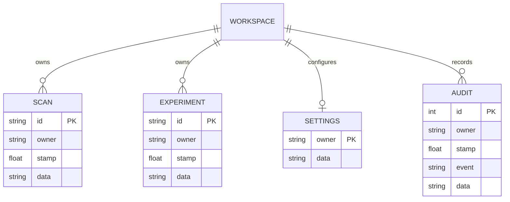

# Architecture and design

## Components

Flask provides a factory and two blueprints. The original page/API blueprint uses the new layered engine for runtime scans. The advanced blueprint implements source inspection, evaluations, auth, policy, gateway and evidence pages. Existing CombinedDetector and legacy evaluation scripts remain available as reproducible baselines.

LayeredEngine inspects the original plus bounded transformed copies, deduplicates rule names, separates injection and safety contributions, identifies recognized sensitive data, attaches source/language/timing metadata and calls the central policy. Source inputs also run unmasked pattern inspection so a quoted attack in retrieved content is not treated as an educational user request. Educational masking for direct user scans remains a heuristic and can be evaded.

Normalization permits two decoding rounds and at most 16 candidates, plus a normalized copy. No data is evaluated as Python/JavaScript or executed as instructions. ML is lazy-loaded once per worker, trains on development JSON, and has an independent data fingerprint. Engine fingerprints cover detector/service source and rule data; restart workers after changing them.

## Gateway sequence

```mermaid
sequenceDiagram
  participant C as Client
  participant G as Gateway
  participant P as Layered engine / policy
  participant B as Backend
  C->>G: Prompt, history, source data
  G->>P: Inspect input and each untrusted source
  P-->>G: Decisions and evidence
  alt REVIEW or BLOCK
    G-->>C: Stop; backend not invoked
  else ALLOW or WARN
    G->>G: Enforce optional calculator permission
    G->>B: Controlled model request / dry-run
    B-->>G: Bounded response
    G->>P: Inspect generated output
    P-->>G: Output policy
    G-->>C: Release redacted text or suppress
  end
```

Only the calculator can run and it uses a bounded AST walker. The model receives no tools. Review means stop and revise/resubmit; there is no insecure automatic approval switch. Audit events record decisions without prompt/output bodies.

## Persistence



WORKSPACE is a logical identity, not a database table. Anonymous sessions store an unpredictable workspace ID in a signed cookie; authenticated identities use `user:<name>`; a valid service token uses `service`. SQLite queries constrain owner values, preventing ID guessing from retrieving another workspace's scan/run. Other tables store hashed local accounts and minute quota buckets. SQL values are parameterized; dynamic table names are internal constants.

Full original prompts are off by default. Stored scan evidence includes recognized-secret redaction and hashes; sensitive previews are omitted. Enabling raw retention knowingly changes this. Expired scans/experiments/audit records are removed on reads for that owner. Scan count is capped at 2,000; displayed audit history is capped at 200 events and run lists at 30 summaries.

Policy is per workspace/account, including privacy controls. An admin edits their own policy; analysts use their workspace defaults. The service token workspace uses defaults. A shared organization-wide policy, multi-tenant administration and centralized credential management would require a separate design.

## Evaluation integrity

Original files remain reproducible. Dataset audits validate IDs/labels/text and compare normalized text and word-set similarity. Clean evaluation excludes candidate overlaps in memory; it never rewrites a holdout to hide weak results. Main/combined is a deliberate alias.

Rules evaluation uses original-text detector behavior; hybrid adds bounded variants and optional ML evidence; ML mode predicts from the lexical classifier alone. Fixed binary thresholds make run comparisons repeatable. The combined corpus label groups injection, harmful requests and data handling; it is not a pure injection benchmark. Category and language tables expose some of that composition. A new independent, human-labeled corpus is still needed.

## Operational limits

SQLite and in-process model caches suit local coursework and small deployments. Requests run synchronously; large lab runs can occupy a worker, quotas are per workspace, and retention cleanup is lazy. There is no worker queue, distributed rate limiting, enterprise identity, vector database, external URL fetching or model-driven tool execution. These are explicit project boundaries.
